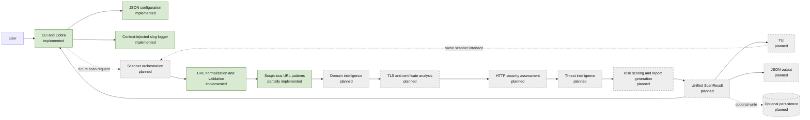

# Bouclier Architecture

## Project overview

Bouclier is a Go CLI foundation for phishing detection and website security assessment. It aims to help security-conscious users, incident responders, developers, and administrators inspect suspicious URLs and understand website security signals in one report.

Phishing detection asks whether a URL or site may be deceptive or malicious. Website security assessment examines properties such as transport security, certificate validity, and HTTP security controls. These concerns overlap, but they are not interchangeable: a site can have good TLS and still be a phish, and a legitimate site can have weak security settings without being a phishing site.

### Implemented today

- Cobra CLI with `--help`, `--version`, and `--config`.
- JSON configuration loading, defaults, strict unknown-field handling, and validation.
- A standard-library `log/slog` logger with text and JSON handlers, levels, and command-context injection.
- Pure HTTP/HTTPS URL parsing, normalization, and offline destination classification in `internal/heuristics`, including IP and local-name characteristics.
- Go tests, Makefile developer targets, and a GitHub Actions verification workflow.

The CLI currently loads configuration and initializes the logger; the URL helper is an independently testable package and is not yet invoked by a scan command. **Bouclier does not perform phishing detection, scan websites, inspect certificates, fetch websites, query threat feeds, calculate risk, persist scan results, or provide a TUI.** Those are planned capabilities described below.

## High-level architecture

The intended application has a thin interface layer over a reusable scanning engine. The CLI and future TUI submit the same `ScanRequest` to the same scanner interface and consume the same `ScanResult` model. The scanner must not import Cobra, terminal UI packages, or presentation code. This keeps scanning usable from another interface or a future service without changing its core.

1. **CLI layer** — parses flags, loads configuration, creates the application logger, validates command input, invokes the scanner interface, and renders output. The Cobra root and bootstrap path exist; scan commands do not.
2. **Scanner orchestration** — coordinates analysis modules, applies shared time and concurrency budgets, gathers findings, and returns a unified result. Planned; no scanner package exists yet.
3. **URL intelligence and heuristics** — the pure HTTP/HTTPS parser and normalizer is implemented. Suspicious URL pattern checks for hostname and path structure are implemented; brand impersonation and typosquatting signals are implemented; broader URL analysis remains planned.
4. **Domain intelligence** — gathers domain and DNS facts useful to assessment, subject to destination and privacy policy. Planned.
5. **TLS and certificate analysis** — inspects the negotiated connection and certificate properties, returning structured observations. Planned.
6. **HTTP security assessment** — performs bounded requests and evaluates response properties such as security headers and redirect behavior. Planned.
7. **Threat intelligence** — consults configured feeds or providers and records source and freshness with each result. Planned.
8. **Risk scoring and reporting** — combines findings under a documented policy, produces a score and verdict, and renders a unified report. Planned.
9. **Persistence** — optionally stores reports or cache entries. SQLite is a future choice; no database code exists.
10. **TUI layer** — presents the same scan interfaces and report models interactively. Planned; the current `internal/tui` directory is a placeholder only.

Modules should communicate through explicit request/result values or narrow interfaces. Analysis modules emit structured findings with evidence, severity, and confidence. The scoring policy, rather than any individual module, determines the overall score and verdict.



Solid green nodes are present in the current foundation. Dashed gray nodes and dashed request/storage edges describe planned work.

## Proposed package structure

The current tree is the starting point. A directory containing only `.gitkeep` is a repository placeholder, not an implemented Go package. Add packages when implementation begins; do not create empty source packages merely to match this proposal.

```text
.
├── cmd/                       # Cobra interface and command wiring (implemented)
├── internal/
│   ├── config/                 # JSON config, defaults, validation (implemented)
│   ├── logging/                # slog construction and context helpers (implemented)
│   ├── scan/                   # scanner contracts and orchestration (planned)
│   ├── heuristics/             # url.go normalization, classification, and URL pattern signals
│   ├── domain/                 # DNS/domain analysis (placeholder directory)
│   ├── cert/                   # TLS/certificate analysis (placeholder directory)
│   ├── fetch/                  # bounded HTTP access (placeholder directory)
│   ├── score/                  # policy and score (placeholder directory)
│   ├── intel/                  # threat-feed adapters (placeholder directory)
│   ├── storage/                # persistence adapters (placeholder directory)
│   └── tui/                    # terminal interface (placeholder directory)
├── configs/                    # safe example config (implemented)
├── docs/                       # project documentation (implemented)
├── scripts/                    # developer scripts (placeholder directory)
├── tests/                      # reserved for cross-package tests (placeholder)
├── main.go                     # process entry point (implemented)
├── Makefile                    # developer workflows (implemented)
├── README.md
└── go.mod
```

| Package | Responsibility | Depends on | Status |
|---|---|---|---|
| `main` | Process entry point; prints a returned error once and chooses the exit status. | `cmd` | Implemented in `main.go` |
| `cmd` | Cobra command construction, config selection, logger initialization, and future CLI rendering. | Cobra, `internal/config`, `internal/logging`, future scanner interface | CLI foundation implemented; scanning planned |
| `internal/config` | JSON config types, defaults, loading, duration encoding, and validation. | Go standard library | Implemented |
| `internal/logging` | Creates configured `slog` loggers and passes them through context. | Go standard library, `internal/config` | Implemented |
| `internal/scan` | Shared scan contracts and orchestration across analysis modules. | Core model/types and narrow analysis interfaces | Planned; directory not present |
| `internal/heuristics` | Pure HTTP/HTTPS URL normalization, classification, and explainable structural findings. | Go standard library and `golang.org/x/net` | URL normalization, destination classification, and structural pattern analysis implemented; other heuristic analysis planned |
| `internal/domain` | DNS and domain intelligence findings. | Shared scan types; bounded resolver abstraction | Placeholder directory; planned |
| `internal/cert` | TLS handshake and certificate findings. | Shared scan types; safe connection abstraction | Placeholder directory; planned |
| `internal/fetch` | Safe, bounded HTTP requests and response metadata. | Shared scan types; standard library networking | Placeholder directory; planned |
| `internal/intel` | Threat-feed adapters, freshness, and source attribution. | Shared scan types; feed/client interfaces | Placeholder directory; planned |
| `internal/score` | Converts findings into policy-versioned risk score and verdict. | Findings and scoring policy | Placeholder directory; planned |
| `internal/storage` | Optional report/cache persistence. | Core report contract; storage driver boundary | Placeholder directory; planned |
| `internal/tui` | Interactive presentation using the shared scanner interface and report. | Scanner/report contracts and future TUI libraries | Placeholder directory; planned |

The `configs`, `docs`, `scripts`, and `tests` directories are repository areas rather than Go packages. At present, `configs` contains an example JSON file; `docs` contains this architecture document; `scripts` and `tests` contain placeholders. Unit tests currently live beside their Go packages.

### Dependency boundaries

- `main` may depend on the application command package; reusable internal code must not import `main`.
- `cmd` is an adapter. Core scan, domain, fetch, TLS, scoring, and intelligence packages must not import `cmd` or Cobra.
- `internal/config` should remain a standard-library leaf; it must not import command, logging, scanner, or storage code. `internal/logging` may use config and the standard library, but must not import command, TUI, or scanner implementations.
- The scanner and analysis packages must not import `internal/tui` or presentation/terminal packages.
- `internal/heuristics` depends on the Go standard library and `golang.org/x/net` for IDNA and Public Suffix List data. As scan contracts are introduced, it may use shared finding types; it must not import interface packages. `internal/domain`, `internal/cert`, `internal/fetch`, and `internal/intel` may depend on shared scan contracts and narrowly scoped interfaces. They must not import interface packages or one another in arbitrary chains; orchestration owns sequencing.
- `internal/score` consumes findings and scoring policy, not CLI/TUI state or network clients.
- Storage is an optional adapter around core report contracts; core analysis must remain usable without a database.
- `internal/tui` consumes the same core interface and report model as `cmd`; neither interface should be required by the other.
- Config and logging may be injected at startup. Analysis packages should receive only the specific settings and logger they need rather than read process globals.

## Intended data flow

```text
Input URL
  -> URL normalization and validation
  -> URL heuristic analysis
  -> Domain intelligence
  -> TLS analysis
  -> HTTP security assessment
  -> Threat intelligence lookup
  -> Risk scoring
  -> Unified scan report
  -> CLI / TUI / JSON output
  -> Optional persistence
```

The orchestration layer should pass request context and bounded settings to modules, collect their structured findings, and apply a single scoring policy. Modules report observations; they do not independently declare the final verdict. Persistence is optional and should not prevent a report from being produced when storage is unavailable.

## Core data contracts (planned)

These names describe future concepts, not types currently implemented in the repository:

- **`ScanRequest`** — normalized input plus caller options, such as the URL and requested assessment depth.
- **`Finding`** — one attributable observation with module/source, safe evidence, severity, confidence, and optional remediation.
- **`Severity`** — potential impact if the finding is true (for example informational through critical).
- **`Confidence`** — how strongly the evidence supports that finding. It is separate from severity.
- **`RiskScore`** — a policy-derived, bounded summary of findings, ideally carrying policy/version metadata.
- **`Verdict`** — a concise result such as benign, suspicious, malicious, or inconclusive; it must reflect policy and uncertainty rather than any single signal.
- **`ScanResult`** — the unified report: request identity, timestamps, findings, score, verdict, module status, and errors/limitations.

Illustrative only:

```go
type Finding struct {
	ID         string
	Source     string
	Severity   Severity
	Confidence Confidence
	Summary    string
}

type ScanResult struct {
	Findings []Finding
	Score    RiskScore
	Verdict  Verdict
}
```

The actual contracts should be designed with stable serialization and safe evidence handling when scanner implementation begins. Avoid embedding secrets or raw sensitive URL query values in reports and logs.

## Security design principles

The following are required constraints for future scanner code. They are **not claims that these controls exist today**; Bouclier currently makes no network requests.

- Block loopback, private, link-local, multicast, unspecified, and otherwise prohibited destination IPs by default.
- Treat user-supplied URLs and redirects as SSRF inputs. Validate scheme, host, port, and resolved addresses before connecting.
- Resolve DNS and reject prohibited addresses; revalidate every redirect destination. Defend against DNS rebinding by binding the validated destination to the actual connection (while preserving correct host and TLS SNI behavior) or an equivalent safe dial strategy.
- Apply request, DNS, and TLS timeouts, plus bounded redirect counts, response sizes, and scan concurrency.
- Never execute downloaded content. Avoid rendering active content in terminal output.
- Never log credentials, authorization data, tokens, or sensitive URL query parameters. Sanitize values at the point they enter logs and reports.
- Handle malformed URLs, DNS responses, HTTP responses, and certificates as ordinary input errors; do not panic or trust partially parsed data.
- Treat threat feeds as untrusted input: validate formats, cap sizes, record provenance/freshness, and do not let a feed response execute code or directly dictate a verdict without policy.

### Internationalized hostnames

The Go net/url package parses URL syntax but does not convert Unicode hostnames to IDNA ASCII. Bouclier uses golang.org/x/net/idna Lookup for lookup normalization, validates the result with the IDNA Registration profile, and checks A-label decoding and round trips. Valid Unicode and existing Punycode hostnames become lowercase ASCII-compatible hostnames for parsing and comparison. NormalizedURL.OriginalHostname preserves the submitted hostname while NormalizedURL.Hostname stores the normalized form. Invalid UTF-8 hostnames are rejected. IDN normalization is not a threat verdict and does not provide comprehensive visual-confusable detection.

## Dependency policy

Prefer the Go standard library and keep direct dependencies limited. Add a library only when it provides meaningful value and can be isolated behind a small interface. Avoid unnecessary application frameworks, and keep scanner components testable without live networks or a database.

The direct dependencies are Cobra (`github.com/spf13/cobra`) for CLI handling and `golang.org/x/net` for IDNA and Public Suffix List support. The latter pulls `golang.org/x/text` transitively for IDNA processing. Versions are recorded in `go.mod`/`go.sum`. Bubble Tea, Bubbles, Lipgloss, and SQLite are possible future choices, not current dependencies; select them only when those phases are implemented.

## Foundation review

- **Configuration:** defaults, path fallback when home resolution fails, positive timeout/cache validation, redirect/concurrency checks, non-empty database path/user agent, and supported log-level validation are present. JSON duration strings and unknown-field rejection are covered by tests. `Load` and decoding errors retain context with `%w`.
- **Logging:** a logger is created once in the root command's normal execution path and added to command context. It has no package-global logger state. Help and version bypass `RunE`, so they remain clean. There are no current scan events to log.
- **CLI and entry point:** each `Execute` builds a fresh Cobra root; `main` prints returned errors once and exits non-zero. Cobra's error/usage output is silenced to avoid duplicate reporting.
- **Package dependencies:** the current direction is `main -> cmd -> config/logging`; config and logging do not import command code. Placeholder analysis directories contain no Go packages, so future boundaries still need enforcement during implementation.
- **Build automation and CI:** Make targets cover formatting, checks, tests, vet, build, and install; Windows uses an `.exe` name and PowerShell cleanup. CI uses Ubuntu and the Go version from `go.mod`.
- **Ignore rules and dependencies:** build, editor, environment, coverage, OS, and future SQLite artifacts are excluded while examples/docs remain trackable. `go.mod` declares Go 1.22, Cobra and x/net as direct dependencies, and x/text as an indirect dependency.

### Remaining foundation work

- Scanner interfaces, finding/report contracts, scanner behavior, and end-to-end CLI tests do not exist yet.
- Existing tests cover config and logger behavior, but there are no tests for Cobra startup, logger context injection, or the process-level error path.
- The application version is duplicated in the config defaults and Cobra command; keep them synchronized or centralize version injection when release/version management is added.
- The example database path uses a `~` notation, while the current config loader treats configured paths as literal strings. Path expansion should be specified before storage code consumes it.
- Other higher-level URL heuristics and scan/report contracts remain unimplemented.
- SSRF protections, safe network behavior, feed trust controls, and persistence security must be designed and tested before network or storage features are enabled.

The foundation is suitable for beginning Phase 1 **design and implementation**, but it is not a production scanner and its future network-safety controls remain unimplemented.

## URL destination classification (Phase 1)

`internal/heuristics.ClassifyURL` consumes the hostname already parsed by `NormalizeURL`; it does not parse a URL again, resolve DNS, or contact a host. It distinguishes DNS names, IPv4 literals, IPv6 literals, and local-name indicators (`localhost`, `.localhost`, `.local`, and `.internal`). For IP literals, it reports standard address properties and excludes a small documented set of special-use prefixes from its conservative `IsPublicIP` approximation. These fields describe destination characteristics only: they are not safety or threat verdicts, and the prefix list is not a complete routing registry.

## Suspicious URL pattern signals (Phase 1)

`internal/heuristics.AnalyzePatterns` applies deterministic, offline checks to a normalized URL and its `ClassifyURL` result. It returns explainable findings only; it does not assign a malicious verdict or score. The current checks cover deep label structure (using the Public Suffix List effective top-level domain plus one), URL userinfo, hostname length over 100 characters, more than three hostname hyphens, digit runs longer than seven, paths longer than 200 escaped characters, more than eight non-empty path segments, repeated path slashes, long consecutive percent-escape runs (60 or more characters), repeated path characters (32 or more), IP literal destinations, and paths beginning with an `http://` or `https://`-like prefix.

These thresholds are conservative heuristics, not universal phishing rules. Long but legitimate hostnames and paths can trigger findings, while harmful URLs can avoid every check. Query strings are not searched for path patterns, and evidence is summarized without recording userinfo credentials or query values. The subdomain rule uses `publicsuffix.EffectiveTLDPlusOne`; if the PSL cannot derive a registrable domain, it emits no depth finding rather than guessing.


## Brand impersonation signals (Phase 1)

`internal/heuristics.AnalyzeBrandImpersonation` compares the normalized DNS hostname against a small built-in registry of 15 brands and selected known aliases. It checks for edit-distance and adjacent-transposition similarities, a limited ASCII confusable mapping, exact brand labels on unlisted suffixes, brand names in subdomains, and brand names combined with hyphenated terms. Findings are deterministic and informational; they do not establish domain ownership or a malicious verdict.

The matcher derives registrable domains with `publicsuffix.EffectiveTLDPlusOne`, including multi-label suffixes, and compares canonical domains, aliases, the registrable label, and hostname subdomain labels. It does not verify current domain ownership or cover every legitimate brand alias. IDN checks use IDNA lookup conversion and a deliberately small Greek/Cyrillic lookalike mapping; this is not comprehensive Unicode homograph analysis or a full confusables dataset. Keep the registry small and review aliases before adding them because legitimate services can use similar names.

## Unified URL intelligence API (Phase 1)

`internal/heuristics.AnalyzeURL(raw string)` is the public entry point for the Phase 1 URL intelligence engine. On success it returns an `AnalysisResult` containing the sanitized URL representation, destination `Classification`, and deterministic `Finding` list. The result omits userinfo, query parameters, and fragments so raw credentials and tokens are not retained in the result.

The engine runs the following offline pipeline: URL normalization and validation; destination classification; structural URL pattern checks; brand impersonation checks; suspicious public-suffix checks; known shortener checks; and account-related keyword checks. The existing `AnalyzePatterns` orchestration is reused, so detectors are not run twice. Findings are deduplicated by stable code and sorted by code in `AnalyzeURL` for consistent reporting. `NormalizeURL`, `ClassifyURL`, and `AnalyzePatterns` remain available for callers that need the lower-level contracts.

`Finding` currently contains a stable code, title, explanation, category, and concise evidence. Severity, confidence, scoring, and verdict are intentionally not part of this Phase 1 contract; they require a later policy design rather than arbitrary placeholder values. A heuristic finding is an observation for review, not confirmation that a URL or site is malicious. The Phase 1 engine performs no DNS resolution, HTTP requests, TLS handshakes, or other network access.

## Domain structure analysis (Phase 2.1 and 2.2)

`ExtractDomainInfo` provides a reusable canonical representation of the hostname, PSL-derived registrable domain and suffix, subdomain labels, domain labels, and DNS label depth. `AnalyzeDomainStructure` is an independent structural analyzer over that model. It reports deep subdomain nesting, long hostnames or labels, unusually hyphenated labels, numeric-heavy labels, and combinations of account-related subdomain terms. The analyzer documents its thresholds in code and returns observations only.

Domain structure analysis is not currently connected to `AnalyzePatterns` or `AnalyzeURL`. This keeps Phase 1 behavior and existing URL finding codes stable while domain-level thresholds are reviewed independently. The API performs no DNS, HTTP, WHOIS, or external intelligence lookups and does not produce a score or verdict.

`AnalyzeDomainBrandRelationships` is a separate hostname-only API that reuses the Phase 1 brand registry, aliases, Public Suffix List extraction, and conservative similarity functions. Its new domain-level classifications include brand references embedded in a registrable label and a normalized similarity code for typo-like registrable labels; it also emits existing Phase 1 codes for misleading brand subdomains and limited IDN comparisons. Those latter checks intentionally overlap with `AnalyzeBrandImpersonation`. The new API is not connected to `AnalyzePatterns` or `AnalyzeURL`, preventing duplicate Phase 1 findings until the two outputs are reviewed together. IDN comparison uses only the existing limited mapping and is not comprehensive Unicode confusable detection.

## Domain registration intelligence foundation (Phase 2.4)

`internal/registration` owns provider-independent domain registration metadata, a `Provider` interface, response normalization and validation, and pure registration-age analysis. `RegistrationInfo` stores only domain-level fields; provider adapters must discard registrant contact objects and other personal data before creating a model. Dates are normalized to UTC, optional zero dates become unavailable, and missing or redacted dates do not imply suspicious activity.

`NormalizeDomain` applies IDNA lookup conversion and the Public Suffix List to derive a lowercase ASCII registrable domain. `Lookup` validates the request and provider response, preserves typed provider errors through wrapping, checks cancellation, and rejects records for a different domain. The interface is ready for a future RDAP adapter, but no HTTP, WHOIS, RDAP, DNS, or other external registration lookup is implemented in this phase.

`AnalyzeRegistrationAge` uses only the caller-supplied time. Less than seven days is labeled very new, seven to under thirty days newly created, and thirty days or more established. Missing or redacted dates are reported as unavailable/redacted, and future creation dates are rejected. These age bands are contextual observations, not verdicts or scores. A future orchestration layer may translate the structured age result into a `Finding` without making the registration package depend on `internal/heuristics`.

## Unified domain analysis (Phase 2.5)

`internal/domain.AnalyzeDomain` orchestrates validated `heuristics.DomainInfo` through domain structure analysis and brand relationship analysis. It retains the supplied domain model, deduplicates findings by stable code and then by trimmed evidence, preserving the first occurrence in pipeline order, and sorts the remaining findings by code for output. Similar but non-identical evidence and different codes remain separate observations; Phase 1 URL analysis is not modified or included in this result.

`AnalyzeDomainWithRegistration` is the explicit optional registration boundary. Callers pass a `RegistrationInfo` and a current time to include the existing pure age analysis. Nil registration data omits that result, and this method never chooses or invokes a provider. Only `AgeAnalysis` is included; the source registration record is not copied into the result. The package depends on heuristics and registration, while neither of those packages depends on `internal/domain`; this avoids a circular dependency and keeps CLI/TUI and network access out of the analysis layer.

## TLS connection inspection (Phase 3.1)

`internal/tlscheck.InspectConnection` performs bounded TLS connection inspection and returns the negotiated protocol/cipher and peer/verified certificate chains. It uses the application's existing scanner HTTP timeout as the overall operation timeout and TLS handshake timeout as the separate handshake limit through `ConnectionConfigFromScannerConfig`. The default TLS port is 443. Certificate verification remains enabled with Go's system trust roots and the effective TLS server name; verification is never bypassed.

Before dialing, the inspector rejects IP literals and DNS names in loopback, private, link-local, multicast, unspecified, special-use, or local-only ranges, including single-label names. DNS lookup collects the complete resolved address set and rejects the entire result if any address is prohibited. It then dials a validated IP literal directly, rather than resolving the hostname again, preventing a DNS rebinding check/use gap. `TLSConnectionResult.TargetHostname` identifies the normalized hostname used for DNS and policy validation; `Address` records the pinned IP and port. `ServerName` identifies the effective TLS server name used for SNI and certificate hostname verification. It defaults to the target hostname; an explicit `ConnectionConfig.ServerName` may intentionally differ, but cannot alter DNS resolution, destination validation, or the pinned TCP address. Context cancellation, an overall connect/lookup timeout, and a separate handshake timeout bound the operation.

On a successful handshake, the result has `HandshakeSuccess=true`, peer certificates, and any verified chains. If TLS certificate verification fails after the peer presented a certificate, `InspectConnection` returns a non-nil result with `HandshakeSuccess=false` together with the contextual verification error. Those peer certificates are untrusted metadata and `VerifiedChains` is empty. If a later handshake step fails after normal certificate verification succeeded, the result can still carry that verified chain while `HandshakeSuccess` remains false. If no peer certificate was received, the method returns a nil result with the error. Certificate metadata availability does not imply handshake success, and untrusted certificates are never represented as verified.

This component only establishes the verified TLS connection and extracts the peer chain. Revocation/OCSP checking, certificate policy findings, risk scoring, and final verdict generation are not implemented. It is not integrated into the CLI/TUI or domain analysis flow yet.

## Certificate analysis (Phase 3.2)

`internal/certanalysis.AnalyzeCertificates` analyzes only the peer certificates already captured by `tlscheck`; it performs no network operations. It uses the effective `TLSConnectionResult.ServerName` for standard `x509.Certificate.VerifyHostname` checks, not the connection target when an explicit TLS identity override was supplied. The connection target and TLS identity are retained as separate fields in the analysis result.

The analysis reports three independent checks. `PathTrusted` verifies the signatures, CA constraints, server-auth EKU, and selected trust-root path while deliberately ignoring validity dates on presented peer certificates. It uses copies with only `NotBefore` and `NotAfter` widened; original certificates and supplied root pools are not mutated, and root validity remains checked. `ChainValidAtTime` runs `x509.Verify` against the original leaf and intermediates at the selected UTC analysis time (or current time when omitted), using the supplied or system roots and server-auth EKU. It does not check the hostname. `HostnameMatch` separately checks the leaf against the effective TLS server name. `ChainTrusted` remains a deprecated compatibility alias for `PathTrusted`.

Each path and full-chain check has a `VerificationStatus`: `verified` means the check completed successfully, `failed` means it completed and rejected the path, and `unavailable` means it could not be performed, such as when system roots cannot be loaded. An explicitly empty root pool is available and produces a failed trust check. The booleans indicate positive results only; use statuses to distinguish failed checks from unavailable checks. Expiration findings on presented certificates remain separate from trust-path results. None of these fields alone is a final security verdict; callers should consider certificate findings, hostname matching, handshake success, and whether verification was available.

When `tlscheck` returns peer certificates alongside a failed handshake, the analyzer still evaluates the available metadata and preserves the failed-handshake state. Presented certificate metadata is not proof of trust, and `HasCertificate` or `ChainTrusted` does not imply that the TLS handshake succeeded. Self-signed status requires the certificate's own public key to verify its signature, and is reported as an observation rather than a malicious verdict. This phase does not implement certificate transparency, OCSP/CRL revocation, scoring, or verdict generation.

## Certificate Transparency foundation (Phase 3.3)

`internal/ct` defines provider-independent `Query`, `CTEntry`, and `CertificateSummary` models plus the `Provider` interface. This task does not include an HTTP client or call a public CT service. `QueryEntries` validates a caller's query, invokes an explicitly supplied provider, then normalizes, scope-filters, deduplicates, sorts, and applies the requested result limit. Provider and context errors are wrapped without losing `errors.Is` matching; empty scoped results return `ErrNoResults`.

Queries explicitly choose `exact_hostname` or `registrable_domain` scope. Exact-hostname scope keeps the normalized hostname and includes only entries with that exact normalized DNS SAN. Registrable-domain scope requires the supplied domain itself to be the Public Suffix List-derived registrable domain and includes names only when their own registrable domain equals it; subdomain input is rejected instead of silently broadened, and substring matches or unrelated registrable domains are excluded. Both scopes normalize IDNs to lowercase IDNA ASCII, remove a trailing dot, reject IP literals and domains without a registrable domain, and have bounded result limits.

Entries expose selected certificate summary fields only. Log IDs must be 32-byte RFC 6962 SHA-256 identifiers encoded with padded standard base64. Log URLs must be HTTPS DNS URLs without credentials, query strings, or fragments; IP and single-label/local hostnames are rejected. Normalization validates timestamps, certificate metadata, serials, SHA-256 fingerprints, and DNS SANs; times become UTC, SANs are IDNA ASCII, serials are uppercase hexadecimal without leading zeroes, and fingerprints are lowercase hexadecimal without separators. Exact duplicate log ID/leaf index pairs collapse; conflicting records with the same identity are rejected as an invalid provider response. Results sort by timestamp, log ID, and leaf index before limiting.

CT records are historical issuance/transparency observations. A log entry does not establish that a certificate is currently deployed, trusted, valid at the present time, or associated with a malicious site. The provider-independent query API is implemented separately from the ctlogs.dev network adapter.

### ctlogs.dev provider (Phase 3.4)

`CTLogsDevProvider` is the first network-backed `Provider`, fixed to `https://api.ctlogs.dev`. Exact-hostname queries use `/v1/domain/{hostname}`; registrable-domain queries use `/v1/subdomains/{registrableDomain}`. Search rows supply certificate IDs, which are path-escaped and fetched sequentially from `/v1/cert/{id}`. Each returned sighting maps its log ID, log URL, SCT timestamp, and leaf index to one `CTEntry`; the certificate summary maps the documented subject/issuer, DNS SANs, validity dates, serial, and final-certificate fingerprint (falling back to the precertificate fingerprint). API log IDs are decoded from 32-byte hexadecimal and encoded as padded standard Base64 for the model.

The production origin is not user-configurable. Optional API keys are sent only through `Authorization: Bearer`; returned URLs are treated as metadata and never fetched. Defaults are a 10-second per-request timeout, 100 certificate-detail lookups, 10 search pages, and a 4 MiB response-body limit; configurable hard ceilings are 2 minutes, 1,000 detail lookups, 100 pages, and 16 MiB. Anonymous use is capped at 10 pages. Redirects are rejected, requests are serialized across provider instances within the process, and no retries are attempted. HTTP 404 search responses map to no results, 429 to rate limited, 401/403 to authentication failure, 5xx to provider unavailable, malformed responses to invalid response, and configured caps or API `history_truncated` indications to `ErrResultsTruncated` with any partial entries. Callers must inspect that error and not treat partial data as exhaustive.

ctlogs.dev's default search history covers certificates currently valid or expired within the last 90 days; older issuance records may be unavailable without a different plan. Anonymous use has shared rate limits and capacity, so availability and returned history depend on the external service and account plan. CT records remain issuance observations, not evidence of current TLS deployment, certificate trust, or maliciousness.

## Unified TLS intelligence pipeline (Phase 3.5)

`internal/tlsintel.AnalyzeTLS` is the reusable sequential orchestration API. It accepts a `context.Context`, an existing `heuristics.NormalizedURL`, and `tlsintel.Options` containing the existing TLS connection configuration, certificate-analysis configuration, optional `ct.Provider`, CT scope/limit, and an optional analysis time. It does not depend on CLI or TUI packages and does not add another network client.

The pipeline validates the normalized URL and hostname using the existing URL and domain APIs, performs bounded `tlscheck.InspectConnection`, analyzes any available peer certificates with `certanalysis.AnalyzeCertificates`, then optionally invokes `ct.QueryEntries`. TLS inspection preserves its existing DNS validation and pinned-IP connection behavior. A peer certificate returned alongside a failed TLS handshake is still analyzed as presented metadata; the analyzer's handshake, hostname, path-trust, and full-chain validity fields retain their independent meanings.

`AnalysisResult` retains the connection and certificate results, CT entries, certificate findings, per-component statuses, target hostname, and analysis time. Findings are deduplicated by `(code, evidence)` and sorted by code then evidence. Only certificate findings are merged; CT entries remain contextual observations and do not create findings, scores, or verdicts.

Component state values are `completed`, `partial`, `failed`, `skipped`, and `no_results`. A nil CT provider and IP-literal CT ineligibility produce `skipped`; an empty CT response produces `no_results`; retrieval truncation preserves returned entries and produces `partial`; other provider failures produce `failed`. Each status retains its wrapped `Err` for `errors.Is` checks and a displayable error string. CT failures do not erase TLS/certificate output and are not fatal to the overall call.

Nil, malformed, or inconsistent input, an unsupported CT scope, and invalid orchestration options are fatal and return no result. Operational component errors are exposed in the corresponding status and return a partial result with a nil top-level error. If the caller's context is cancelled or expires, any already-collected result is returned with a context-wrapped top-level error. This lets callers use `errors.Is` while retaining useful partial data. The analysis time is captured once per run (or supplied explicitly) and shared with certificate analysis.

The default CT scope is explicitly `exact_hostname`; registrable-domain scope is opt-in and uses `heuristics.ExtractDomainInfo` and the Public Suffix List. CT results do not change certificate trust. Phase 4 and Phase 5 may consume this structured report for broader checks and scoring, but those phases are not implemented here and Phase 3 does not produce a complete phishing verdict.

## Passive web security assessment (Phase 4)

`internal/webcheck` owns the bounded HTTP client and individual response analyzers. `webcheck.NewClient` creates a GET-only client with an overall context timeout, a 2 MiB default body limit (32 MiB hard maximum), five redirects by default (20 hard maximum), and a configurable User-Agent. It does not inherit environment proxies, sends no cookies or authorization headers, and uses only ports 80 and 443. The application scanner timeout and User-Agent defaults are reused; callers may supply their loaded configuration through `webintel.Options.Config` or configure the client directly.

For each URL hop, the client resolves a DNS hostname once, validates every returned address, rejects the entire answer set if any address is unsafe, and dials one of the validated IPs directly. IP-mapped IPv6 addresses are unmapped before validation. Loopback, private, link-local, unspecified, multicast, shared address space, selected special-use ranges, local-only suffixes, single-label names, and IPv6 zones are rejected. Redirect destinations are normalized and revalidated independently before any request is made to them. Redirects are followed manually, loops and excess redirects fail, and cross-origin transitions and HTTPS-to-HTTP downgrades are recorded. The URL hostname remains the HTTP Host and TLS verification/SNI identity while the TCP connection uses the pinned IP. HTML-referenced origins are metadata only and are never fetched.

Response reading is capped at the configured byte limit plus one detection byte. Go's HTTP transport transparently decompresses supported gzip responses, and the decompressed output remains subject to the same cap. `HTTPInspectionResult` records metadata and byte counts; HTML is retained only for HTML content types and is marked truncated when incomplete. Returned URLs omit userinfo, query values, and fragments. Set-Cookie values are kept only in an unexported in-memory field for package analysis; public cookie metadata excludes values. Redirect and Location header URLs are sanitized or removed from returned header data.

`AnalyzeSecurityHeaders` checks HSTS only on HTTPS responses, separates enforced CSP from Report-Only CSP, recognizes CSP frame-ancestors and X-Frame-Options, and reports missing/weak header policies as contextual observations. A preload directive is recorded without claiming preload-list eligibility. `AnalyzeCookies` uses conservative session-like name matching and reports only cookie names/attributes, never values. `AnalyzeCORS` inspects the received headers without Origin or preflight probes; wildcard origin alone is not treated as a vulnerability. `AnalyzeHTML` parses bounded HTML without running scripts or submitting forms, identifies selected active mixed-content references and insecure form actions, and distinguishes a meta CSP from an HTTP policy. It records external origins as metadata but does not resolve or fetch them. `AnalyzeInformationDisclosure` records selected technology-identifying response headers without inferring known vulnerabilities. Example stable codes include `WEB_HTTPS_DOWNGRADE`, `WEB_HSTS_MISSING`, `WEB_CORS_NULL_ORIGIN`, `WEB_HTML_INSECURE_PASSWORD_FORM`, and `WEB_TECHNOLOGY_DISCLOSURE_SERVER`.

`internal/webintel.AnalyzeWebsite` orchestrates optional TLS intelligence for the requested HTTPS hostname, safe HTTP inspection, redirect/header/cookie/CORS/HTML/disclosure analysis, and deterministic finding merge. HTTP targets mark TLS as `skipped`. Redirected URLs remain separately represented; TLS results always describe the requested hostname, so a redirect to another origin is not presented as TLS inspection of that destination. Each component has a `completed`, `partial`, `failed`, `skipped`, or `no_results` status. A truncated body preserves available metadata and marks HTTP/HTML completeness as partial. Operational component errors remain in the result while successful component results are preserved. Cancellation returns available results with a context-compatible error; invalid input or client configuration is fatal. Findings reuse `heuristics.Finding`, deduplicate on `(code, evidence)`, and sort deterministically. No severity, score, or verdict is assigned.

The engine is passive web assessment, not penetration testing or exploitation. It does not execute JavaScript, submit forms, authenticate, probe CORS, brute-force endpoints, fetch embedded resources, query vulnerability feeds, or access private/local addresses. TLS and HTTP inspections are separate bounded operations, so the target may change DNS answers between those operations; each operation independently validates and pins its own destination. Analysis of a truncated HTML document is necessarily incomplete. The internal APIs are not yet wired to a CLI scan command, and the report is not a complete phishing verdict.

## Risk scoring and reports (Phase 5)

`internal/risk` consumes existing URL, domain, TLS, and web findings through `risk.Aggregate`, or accepts normalized observations directly through `risk.NormalizeFindings`. It maps stable finding codes through a central catalog while retaining the original code, description, category, evidence, and source provenance. Unknown codes remain visible with `classification_status: unclassified` and have no scoring weight. Registration age remains contextual metadata because its source API explicitly does not assign risk or provide a finding code.

Severity describes the seriousness of an observed weakness; confidence describes how strongly the evidence supports that finding. They are independent typed values. The initial `bouclier-default` policy version `1.0` assigns integer severity weights (informational 0, low 6, medium 18, high 35, critical 55) and confidence multipliers (low 30%, medium 60%, high 100%). Each finding's base weight is multiplied by its confidence percentage and rounded half up, then capped per finding, category, and assessment. Defaults cap a finding at 50 points, category limits vary by finding family, and the total is at most 100. The result is an explainable product indicator, not a probability or a certified security grade.

Score bands are 0–19 Low, 20–39 Guarded, 40–59 Elevated, 60–79 High, and 80–100 Critical. An empty or zero-score assessment means only that no score-eligible indicators were observed in checks that ran; it does not establish safety. Catalog entries intentionally keep informational items (such as CT/root-store availability context and technology disclosure) out of scoring. CT presence is not a trust signal, absence is not penalized, and registration age alone is not scored.

Normalization deduplicates on canonical target hostname, stable finding code, and whitespace/case-normalized evidence. Identical observations merge their source provenance; distinct evidence for one code remains separately visible. The score calculation also ignores repeated deduplication keys, validates policy bounds, sorts all output collections deterministically, applies category caps, and includes severity counts, category totals, top contributors, and excluded/unclassified findings.

Aggregation exposes coverage per URL, domain, TLS connection, certificate, CT, HTTP, redirect, header, cookie, CORS, HTML, disclosure, and registration-age component. Each component is marked `completed`, `partial`, `failed`, `skipped`, or `no_results`; absent checks are not interpreted as clean results. A failed CT lookup does not increase score. Inputs can add component coverage and limitations without changing analysis package contracts.

`internal/report.RenderJSON` emits the versioned `bouclier-risk/v1` JSON assessment, including the policy version, findings, score, coverage, remediation, and limitations. `RenderMarkdown` presents the same completed assessment as an overview, severity summary, top factors, findings, coverage, limitations, and scoring methodology. The report layer never recalculates scores or verdicts. Both renderers sanitize URLs and secret-like values and operate on copies; no response bodies or authorization/cookie values are part of the aggregation contract. Markdown untrusted text is escaped before insertion.

Known limitations: catalog mappings require maintenance as upstream finding codes evolve; unknown codes are deliberately unscored. The initial policy is a transparent baseline rather than empirically calibrated. Deduplication relies on stable codes and evidence emitted by source packages. Registration observations currently provide age context only. Risk and report packages are library APIs and are not wired to a CLI scan or export command.
