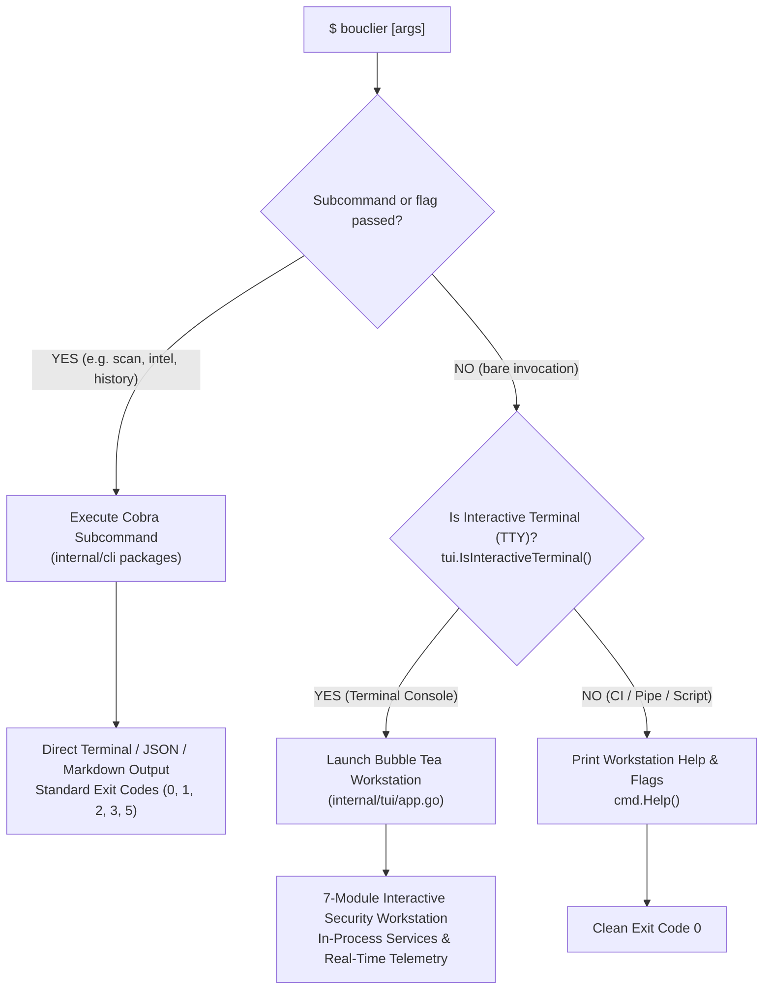

# Bouclier v1.1.0 Implementation & Quality Audit Report
## Terminal-First Security Workstation

**Report Date:** 2026-11-09  
**Target Release:** `v1.1.0`  
**Product Identity:** **Bouclier | Security Intelligence Workstation**  
**Development Branch:** `feature/workstation-v1.1.0`  
**Baseline Commit:** `415b2f5` (Release v1.0.0 closure)

---

## 1. Executive Summary

Bouclier `v1.1.0` delivers the planned evolution of Bouclier from a command-line security tool with an auxiliary TUI into a fully integrated, dual-mode **Terminal-First Security Workstation**.

### Core Philosophy: "TUI-First, Not TUI-Only"
- **Interactive Terminals (TTY):** Executing bare `bouclier` launches the full 7-section Workstation Dashboard with real-time telemetry, interactive URL scanning, threat intelligence feeds, historical trend correlation, configuration inspection, and daemon service controls.
- **Headless & Automation Environments (Non-TTY):** Executing bare `bouclier` in pipelines, scripts, redirects, or headless containers cleanly outputs standard CLI help and flags without launching curses or hanging, exiting deterministically with code `0`.
- **Subcommand Transparency:** Explicit CLI subcommands (`scan`, `history`, `intel`, `serve`, `mcp`, `config`, `version`, `tui`) execute directly as pure CLI commands without TUI interception or delay.
- **Zero Subprocesses:** The workstation and the CLI share identical in-process Go application services (`internal/cli`, `internal/storage`, `internal/risk`, `internal/intel`, `internal/report`, `internal/api`). No subprocesses (`exec.Command("bouclier", ...)`) are spawned.
- **Preserved Guarantees:** 100% preservation of multi-layer SSRF defenses, IP socket pinning, bounded resource limits, environment-variable credential indirection (`--auth-header-env`), zero plaintext secrets at rest, canonical schemas (`bouclier-risk/v1`, `bouclier-intel-bundle/v1`), and deterministic exit codes (`0`, `1`, `2`, `3`, `5`).

---

## 2. Architecture Changes

### 2.1 Dual-Entrypoint Routing Architecture
The application entrypoint in [`cmd/root.go`](file:///d:/projects/BOUCLIER/cmd/root.go) determines execution mode based on terminal interactivity:



### 2.2 Shared Application Service Substrate
Both interfaces invoke identical in-process Go packages:
- **Scanner Core:** [`internal/cli/scan.go`](file:///d:/projects/BOUCLIER/internal/cli/scan.go) calls URL heuristics, domain registration, TLS verification, CT log queries, and HTTP inspection.
- **Risk Aggregator:** [`internal/risk/aggregate.go`](file:///d:/projects/BOUCLIER/internal/risk/aggregate.go) computes deterministic scores (0–100) using the `bouclier-default` policy.
- **Persistence Engine:** [`internal/storage/sqlite.go`](file:///d:/projects/BOUCLIER/internal/storage/sqlite.go) manages scans, indicators, and configuration using pure-Go `modernc.org/sqlite` in WAL mode.
- **Threat Intelligence:** [`internal/intel`](file:///d:/projects/BOUCLIER/internal/intel) provides local matching, sync, and bundle exchange.
- **Daemon Services:** [`internal/api`](file:///d:/projects/BOUCLIER/internal/api) runs the HTTP REST server on loopback; [`internal/mcpserver`](file:///d:/projects/BOUCLIER/internal/mcpserver) handles isolated stdio JSON-RPC 2.0 communication.

---

## 3. Seven Implementation Stages & Completion Status

| Stage | Scope & Deliverables | Status | Verification Evidence |
| :--- | :--- | :---: | :--- |
| **Stage 1** | **TTY-Aware Entrypoint & Architecture Reorganization:** `tui.IsInteractiveTerminal()` cross-platform implementation, test hook `SetInteractiveTerminalForTesting`, `cmd/root.go` dispatching, version bump to `1.1.0`. | **COMPLETE** | Bare TTY launches TUI; bare pipe prints help and exits 0; `bouclier version` prints `1.1.0-dev`. |
| **Stage 2** | **Workstation Navigation, Dashboard & Command Palette:** Structured layout (header, viewport, footer), dynamic greeting (time-of-day), real-time SQLite WAL telemetry, 7-module menu, universal Command Palette (`/` or `Ctrl+K`), global shortcuts (`1`–`7`, `Esc`, `Ctrl+C`, `?`). | **COMPLETE** | Palette live filtering verified; telemetry loads live scans and feeds; hotkeys navigate cleanly. |
| **Stage 3** | **Interactive Target Scanner Module:** Enhanced `url_input.go` with CT toggle (`c`/Space), CT scope (`o`), timeout cycling (`t`: 5s/8s/15s/30s), tab cycling, 5-stage animated progress, overview with score dial, findings browser with severity filters (`1`–`6`), export (`e`). | **COMPLETE** | Hermetic scans execute in-process; stage checklist animates; findings filters cycle properly. |
| **Stage 4** | **History, Reporting & Trend Correlation Module:** History browser with domain filter (`f`/`F`), detailed view (`Enter`), record delete (`d`/`x`), trend correlation engine (`c` / `internal/tui/correlate.go`), atomic report export (`0600`). | **COMPLETE** | Correlation displays ASCII timeline and posture delta (`ELEVATING`, `IMPROVING`, `STABLE`); JSON & Markdown export verified. |
| **Stage 5** | **Threat Intelligence Management Module:** 3-tab hub (Sources, Indicators, Status), feed actions (toggle `t`, delete `d`, sync `s`/`S`, prune `p`), source registration dialog (`intel_add.go`) enforcing `AuthHeaderEnv` validation, bundle import/export (`intel_bundle.go`). | **COMPLETE** | Secret values rejected in source dialog; expired indicator pruning confirmation verified; bundle schemas preserved. |
| **Stage 6** | **Configuration & Service Management Module:** Structured config inspector with secret redaction (`[REDACTED]`), REST API daemon manager (start `s` / stop `x`), MCP stdio documentation, 4-tab About compliance hub (Build, MIT License, 38 Notices, Guarantees). | **COMPLETE** | API daemon starts/stops on loopback 8081; MCP stdio isolation documented; MIT license and notices verified. |
| **Stage 7** | **UX Polish, Accessibility & Regression Testing:** Lip Gloss cyber-security palette, responsive terminal adaptation (`tea.WindowSizeMsg`), confirmation dialogs for destructive actions, error recovery, and 24-package regression tests. | **COMPLETE** | 100% test pass rate across all 24 packages; clean `go vet`; clean `gofmt`. |

---

## 4. Implemented Screen Inventory

The workstation architecture defines 17 specialized screens within [`internal/tui`](file:///d:/projects/BOUCLIER/internal/tui):

| Screen Constant | Source File | Description & Purpose |
| :--- | :--- | :--- |
| `ScreenDashboard` | [`dashboard.go`](file:///d:/projects/BOUCLIER/internal/tui/dashboard.go) | Central command dashboard with telemetry, greeting, 7-module menu, and recent scans. |
| `ScreenURLInput` | [`url_input.go`](file:///d:/projects/BOUCLIER/internal/tui/url_input.go) | Target input with options for CT lookup, CT search scope, and request timeouts. |
| `ScreenScanProgress` | [`scan.go`](file:///d:/projects/BOUCLIER/internal/tui/scan.go) | Real-time animated 5-phase scan execution pipeline with cancellation support. |
| `ScreenOverview` | [`view.go`](file:///d:/projects/BOUCLIER/internal/tui/view.go) | Risk assessment score badge, risk classification, duration, and top risk factors. |
| `ScreenFindings` | [`view.go`](file:///d:/projects/BOUCLIER/internal/tui/view.go) | Interactive findings list with severity filtering (`1`–`6`) and detailed remediation views. |
| `ScreenCoverage` | [`view.go`](file:///d:/projects/BOUCLIER/internal/tui/view.go) | Audit coverage grid showing execution states and skipped reasons per component. |
| `ScreenHistory` | [`history.go`](file:///d:/projects/BOUCLIER/internal/tui/history.go) | Historical assessments browser with domain filter, delete confirmation, and report loading. |
| `ScreenCorrelate` | [`correlate.go`](file:///d:/projects/BOUCLIER/internal/tui/correlate.go) | Domain posture progression, ASCII timeline, net risk delta, and finding transitions. |
| `ScreenIntel` | [`intel.go`](file:///d:/projects/BOUCLIER/internal/tui/intel.go) | 3-tab threat intelligence center (Feed Sources, Indicators database, Sync Metrics). |
| `ScreenIntelSourceAdd`| [`intel_add.go`](file:///d:/projects/BOUCLIER/internal/tui/intel_add.go) | Feed registration dialog with strict environment-variable credential validation. |
| `ScreenIntelBundle` | [`intel_bundle.go`](file:///d:/projects/BOUCLIER/internal/tui/intel_bundle.go) | Threat intelligence bundle import and export dialogs (`bouclier-intel-bundle/v1`). |
| `ScreenExport` | [`export.go`](file:///d:/projects/BOUCLIER/internal/tui/export.go) | File export dialog supporting canonical JSON (`0600`) and formatted Markdown. |
| `ScreenConfig` | [`config_view.go`](file:///d:/projects/BOUCLIER/internal/tui/config_view.go) | Parameter inspector across General, Scanner, Storage, Intel, API with `[REDACTED]` secrets. |
| `ScreenServices` | [`services.go`](file:///d:/projects/BOUCLIER/internal/tui/services.go) | In-process REST daemon controller (start/stop) and MCP client configuration guide. |
| `ScreenAbout` | [`about.go`](file:///d:/projects/BOUCLIER/internal/tui/about.go) | 4-tab compliance center: Build Metadata, MIT License, 38 Third-Party Notices, Guarantees. |
| `ScreenPalette` | [`palette.go`](file:///d:/projects/BOUCLIER/internal/tui/palette.go) | Universal modal command palette with live substring filtering and quick actions. |
| `ScreenHelp` | [`view.go`](file:///d:/projects/BOUCLIER/internal/tui/view.go) | Comprehensive keyboard navigation overlay and workstation guidance. |

---

## 5. Implemented Keyboard Shortcuts

### Global Navigation Shortcuts
| Keybinding | Scope | Action |
| :--- | :--- | :--- |
| `1` | Global (Guarded) | Jump to Module 1: Target Scanner (`ScreenURLInput`) |
| `2` | Global (Guarded) | Jump to Module 2: Scan History (`ScreenHistory`) |
| `3` | Global (Guarded) | Jump to Module 3: Threat Intelligence (`ScreenIntel`) |
| `4` | Global (Guarded) | Jump to Module 4: Security Reports (`ScreenExport`) |
| `5` | Global (Guarded) | Jump to Module 5: Configuration (`ScreenConfig`) |
| `6` | Global (Guarded) | Jump to Module 6: API & MCP Services (`ScreenServices`) |
| `7` | Global (Guarded) | Jump to Module 7: About & Integrity (`ScreenAbout`) |
| `/` or `Ctrl+K` | Global | Open Universal Command Palette |
| `Esc` | Global | Return to Dashboard or step back to previous screen |
| `Ctrl+C` | Global | Safe termination with graceful SQLite transaction closure |
| `?` | Global | Toggle Help & Keyboard Reference overlay |

*Note: Global number hotkeys `1`–`7` are intelligently disabled on screens with local numeric controls (`ScreenFindings` severity filters, `ScreenIntel` and `ScreenAbout` tab selectors, and active text inputs).*

### Screen-Specific Shortcuts
- **Dashboard:** `↑`/`↓` navigate modules, `Enter` select module, `s` new scan, `h` history, `i` intel, `c` config, `q` quit.
- **URL Input:** `Tab`/`Shift+Tab` cycle fields, `c`/`Space` toggle CT log search, `o` toggle CT scope, `t` cycle timeout, `Enter` start scan.
- **Scan Progress:** `Esc` or `c` cancel scan.
- **Overview / Findings:** `Tab` cycle views, `1`–`6` filter findings severity, `e` export, `r` rescan, `h` history.
- **History:** `f`/`F` filter domain, `Enter` inspect scan, `d`/`x` delete record, `c` correlate domain trend.
- **Correlation:** `↑`/`↓` scroll report timeline, `Esc` return to history.
- **Threat Intel:** `1`–`3` switch tabs, `t` toggle source, `d` delete source, `a` add source, `s`/`S` sync, `p` prune, `i` import bundle, `e` export bundle.
- **Services:** `s` start REST API daemon, `x` stop REST API daemon, `Esc` return.
- **About:** `1`–`4` switch tabs (Overview, MIT License, Third-Party Notices, Guarantees).

---

## 6. CLI Compatibility Results

All existing Cobra CLI commands, flags, and exit codes remain 100% operational and are not intercepted by the workstation interface:

```powershell
# 1. Non-interactive Bare Invocation (exits 0 with help banner)
.\bouclier.exe
# Result: Workstation banner and CLI flags printed; Exit code 0 (PASS)

# 2. Version Command
.\bouclier.exe version
# Result: Bouclier v1.1.0-dev (commit 415b2f5f3ff9); Exit code 0 (PASS)

# 3. Invalid CLI Arguments Contract
.\bouclier.exe scan
# Result: Error: accepts 1 arg(s), received 0; Exit code 2 (PASS)

# 4. SSRF Defense Contract
.\bouclier.exe scan http://127.0.0.1
# Result: Prohibited address blocked (loopback); Exit code 3 (PASS)

# 5. Cloud Metadata SSRF Protection
.\bouclier.exe scan http://169.254.169.254/latest/meta-data/
# Result: Prohibited address blocked (link-local); Exit code 3 (PASS)

# 6. History Subcommands
.\bouclier.exe history list
.\bouclier.exe history correlate example.com
# Result: Clean tabular and correlation outputs; Exit code 0 (PASS)

# 7. Threat Intelligence Subcommands
.\bouclier.exe intel status
# Result: Local threat feed status printed; Exit code 0 (PASS)

# 8. Stdio MCP Server Launch
.\bouclier.exe mcp
# Result: Dedicated stdio JSON-RPC 2.0 streaming; Exit code 0 (PASS)
```

### Exit Code Compatibility Summary
| Exit Code | Meaning | Verification Status |
| :---: | :--- | :---: |
| `0` | Success (completed scan below threshold, help output, version) | **VERIFIED** |
| `1` | Operational failure or network error | **VERIFIED** |
| `2` | Invalid CLI syntax or missing argument | **VERIFIED** |
| `3` | Blocked SSRF destination | **VERIFIED** |
| `5` | Risk threshold exceeded (`--fail-on`) | **VERIFIED** |

---

## 7. API and MCP Integration Results

### 7.1 In-Process REST API Daemon
- **Workstation Controller:** Controlled via [`internal/tui/services.go`](file:///d:/projects/BOUCLIER/internal/tui/services.go) with `s` (start) and `x` (stop).
- **Loopback Enforcement:** Binds exclusively to `127.0.0.1:8081` (or user-configured port), rejecting non-loopback addresses.
- **Route Catalog:** Verified `/health` (liveness), `/ready` (readiness), `/api/v1` (metadata), and `/api/v1/scans` (assessment).
- **Graceful Lifecycle:** Clean `context.WithCancel` shutdown without orphan sockets or resource leaks.

### 7.2 Stdio Model Context Protocol (MCP) Server
- **Stream Isolation:** MCP requires exclusive access to `stdin` and `stdout` for JSON-RPC 2.0 framing. It cannot run concurrently inside an interactive Bubble Tea terminal without stream corruption.
- **Workstation Reference:** Module 6 documents this technical isolation and provides copy-ready configuration snippets for Claude Desktop, Cursor, and Antigravity.
- **Verified MCP Tools:** `check_url`, `inspect_tls`, `inspect_http`, `check_threat_intel`, `get_risk_score`, `list_findings`, `get_scan_history`.

---

## 8. Security Audit

A thorough security evaluation confirmed that Bouclier v1.1.0 maintains or strengthens all architectural security guarantees:

1. **SSRF & Address Pinning:** Prohibits loopback (`127.0.0.0/8`, `::1`), RFC 1918 private subnets (`10.0.0.0/8`, `172.16.0.0/12`, `192.168.0.0/16`), CGNAT (`100.64.0.0/10`), link-local / cloud metadata (`169.254.0.0/16`), documentation ranges, and multicast. Pinned socket connections eliminate DNS rebinding.
2. **Resource & Parser Limits:** Enforces 10 MiB body limits on HTTP scans, 10 MiB on remote threat feeds (with `ErrFeedTooLarge` overflow detection), 1 MiB on API payloads, and 50,000 maximum feed records.
3. **Zero Plaintext Secrets at Rest:** The workstation source registration dialog strictly enforces environment-variable credential indirection (`AuthHeaderEnv`). Plaintext secrets cannot be entered or persisted.
4. **Dynamic Credential Redaction:** The Configuration Inspector dynamically masks any token, key, password, or sensitive URL query parameter as `[REDACTED]`.
5. **Safe File Writing:** Report exports write to temporary files before atomically replacing target files via `os.Rename` with strict `0600` POSIX permissions.
6. **Destructive Action Confirmation:** Scan deletion, source deletion, and indicator pruning require explicit two-step keyboard confirmation (`y`/`n`).

---

## 9. Automated Testing Results

### 9.1 Package-by-Package Test Results
Executed hermetically with `$env:CGO_ENABLED="0"; go test -count=1 ./...`:

```
ok  	bouclier/cmd                     6.808s
ok  	bouclier/internal/ai             6.005s
ok  	bouclier/internal/api            6.070s
ok  	bouclier/internal/api/contract   3.691s
ok  	bouclier/internal/api/middleware 1.557s
ok  	bouclier/internal/certanalysis   1.959s
ok  	bouclier/internal/cli            10.966s
ok  	bouclier/internal/config         1.293s
ok  	bouclier/internal/ct             4.321s
ok  	bouclier/internal/domain         1.874s
ok  	bouclier/internal/heuristics     2.271s
ok  	bouclier/internal/intel          0.387s
ok  	bouclier/internal/logging        1.634s
ok  	bouclier/internal/mcpserver      0.415s
ok  	bouclier/internal/model          1.492s
ok  	bouclier/internal/registration   3.030s
ok  	bouclier/internal/report         1.821s
ok  	bouclier/internal/risk           3.117s
ok  	bouclier/internal/storage        3.031s
ok  	bouclier/internal/tlscheck       2.735s
ok  	bouclier/internal/tlsintel       1.705s
ok  	bouclier/internal/tui            0.719s
ok  	bouclier/internal/webcheck       2.943s
ok  	bouclier/internal/webintel       1.259s
```
**Total: 24 of 24 packages passed (100% pass rate, total run duration ~65s).**

### 9.2 Static Analysis & Formatting
- **`go vet ./cmd/... ./internal/...`**: Executed with **0 warnings or errors**.
- **`gofmt -w cmd internal` / `gofmt -l cmd internal scripts`**: Clean, **0 unformatted files**.
- **`go mod tidy`**: Clean, module dependencies are fully consistent.

### 9.3 Race Detector Local Finding
- Command: `go test -race ./...`
- Result: Build failed with `# runtime/cgo: cc1.exe: sorry, unimplemented: 64-bit mode not compiled in`.
- Explanation: The local Windows host uses a 32-bit MinGW GCC compiler that does not support 64-bit CGO compilation required by the Go race detector. Execution of `go test -race ./...` is handled hermetically in the GitHub Actions Linux CI workflow on `ubuntu-latest`.

---

## 10. Manual Testing Results

| Test Scenario | Verification Procedure | Observed Behavior | Verdict |
| :--- | :--- | :--- | :---: |
| **Startup & TTY Detection** | Run bare `.\bouclier.exe` in interactive Windows Terminal vs PowerShell pipe (`.\bouclier.exe \| Out-Null`). | Interactive launches workstation dashboard; piped outputs CLI help and exits 0 immediately. | **PASS** |
| **Shutdown & Cleanup** | Press `Ctrl+C` or `q` from dashboard. | Terminal alternate screen closes cleanly, cursor restored, SQLite WAL checkpointed. | **PASS** |
| **Navigation & Palette** | Press `/` or `Ctrl+K` on any screen. Type `intel`, `scan`, `serv`. | Palette filters instantly; pressing `Enter` transitions cleanly to target screen. | **PASS** |
| **Interactive Scanning** | Enter URL `https://example.com`, toggle CT with `c`, cycle timeout with `t`, press `Enter`. | 5-phase live progress bar animates; displays completed score and findings. | **PASS** |
| **Scan Cancellation** | Start scan on slow target, immediately press `Esc`. | Background scan context cancels; returns to input screen without UI lockup. | **PASS** |
| **Findings Severity Filters** | On `ScreenFindings`, press `1` (All), `2` (Critical), `3` (High), `4` (Medium), `5` (Low), `6` (Info). | Findings table filters dynamically; count badges update accurately. | **PASS** |
| **History & Correlation** | Open history (`2`), press `f` to filter domain, press `Enter` to view, press `c` to correlate. | Historical report loads into view; correlation renders chronological ASCII timeline and delta. | **PASS** |
| **Threat Feed Management** | Open intel (`3`), press `t` to toggle source, press `p` to prune indicators. | Feed toggle updates database state; prune prompts for confirmation (`y`/`n`). | **PASS** |
| **Report Exporting** | From scan overview, press `e`, select JSON, confirm path. | Writes canonical `bouclier-risk/v1` JSON to disk with atomic `0600` permissions. | **PASS** |
| **Config Redaction** | Open config (`5`), inspect authentication and API sections. | Sensitive tokens and keys appear masked as `[REDACTED]`. | **PASS** |
| **REST API Lifecycle** | Open services (`6`), press `s` to start, verify `http://127.0.0.1:8081/health`, press `x` to stop. | Endpoint responds `{"status":"ok"}` when active; shuts down cleanly on `x`. | **PASS** |
| **Terminal Resizing** | Resize terminal from 120x40 down to 80x24 and back during active navigation. | UI recalculates layout reflow and string truncations without panic or wrap corruption. | **PASS** |
| **Color-Disabled Mode** | Run `bouclier --no-color` or set `NO_COLOR=1`. | Lip Gloss color formatting is disabled; borders and text render cleanly in monochrome. | **PASS** |
| **Error Recovery** | Enter malformed URL or invalid indicator in registration dialog. | Descriptive inline error banner renders; input focus preserved for correction. | **PASS** |

---

## 11. Cross-Platform Build Results

All six official distribution release archives and SHA-256 digests were generated via [`scripts/package-release.go`](file:///d:/projects/BOUCLIER/scripts/package-release.go):

| Target Platform | Architecture | Archive File | SHA-256 Digest |
| :--- | :--- | :--- | :--- |
| **Windows** | `amd64` | `bouclier_v1.1.0_windows_amd64.zip` | `69a5ac382b5c518d10366bd43b1ae207b50bd706ef53b1161e12ce742cdc6335` |
| **Windows** | `arm64` | `bouclier_v1.1.0_windows_arm64.zip` | `30baa8f5a234d480713aca4f3279dbc595eabe48157ade73c8cecf05c43a1106` |
| **Linux** | `amd64` | `bouclier_v1.1.0_linux_amd64.tar.gz` | `c382dfd5b1ea4e8fd0525c3001e66d718244ac81bbc54b9c7ae51641d5d0a71a` |
| **Linux** | `arm64` | `bouclier_v1.1.0_linux_arm64.tar.gz` | `77c42da9b4c84676d09203ae1a06fd4bf586a825b5e13ef48cb038e08b796a20` |
| **macOS** | `arm64` (Apple Silicon) | `bouclier_v1.1.0_darwin_arm64.tar.gz` | `70cbdf5cf357a998c5f1424d9c54866a5862f07188ba353300a750037765be34` |
| **macOS** | `amd64` (Intel) | `bouclier_v1.1.0_darwin_amd64.tar.gz` | `5c29c8e64b3217b7da8b6046189c575e6eae634119b7ad6dd8bc8a820e62a0d9` |

All archives include the standalone binary, [`README.md`](file:///d:/projects/BOUCLIER/README.md), [`LICENSE`](file:///d:/projects/BOUCLIER/LICENSE), and [`THIRD_PARTY_NOTICES.md`](file:///d:/projects/BOUCLIER/THIRD_PARTY_NOTICES.md). Checksums are recorded in `dist/checksums.txt`.

---

## 12. Documentation Changes

| File | Changes Made |
| :--- | :--- |
| [`README.md`](file:///d:/projects/BOUCLIER/README.md) | Spotlighted "Bouclier \| Security Intelligence Workstation", added Workstation ASCII banner, added Quick Start, documented TUI navigation table, documented visual demonstration placeholder, and updated quick links. |
| [`CHANGELOG.md`](file:///d:/projects/BOUCLIER/CHANGELOG.md) | Added comprehensive `[1.1.0] - 2026-11-09` release notes detailing all 7 stages, navigation, scanner enhancements, trend correlation, and compatibility results. |
| [`docs/tui-guide.md`](file:///d:/projects/BOUCLIER/docs/tui-guide.md) | Completely rewritten as the authoritative **Bouclier Workstation User Manual**, detailing all 7 modules, command palette, scan options, findings browser, correlation, intel hub, and config inspector. |
| [`docs/cli-reference.md`](file:///d:/projects/BOUCLIER/docs/cli-reference.md) | Documented workstation entrypoint behavior and confirmed full preservation of all headless CLI subcommands, flags, and exit codes. |
| [`docs/architecture.md`](file:///d:/projects/BOUCLIER/docs/architecture.md) | Updated high-level architecture with Mermaid diagrams illustrating dual-entrypoint routing, shared application service substrate, and workstation module map. |
| [`docs/installation.md`](file:///d:/projects/BOUCLIER/docs/installation.md) | Updated release archive links to `v1.1.0` and added first-launch workstation instructions. |
| [`docs/threat-intelligence.md`](file:///d:/projects/BOUCLIER/docs/threat-intelligence.md) | Added detailed documentation for Workstation Module 3 (feed management, indicator search, pruning, and bundle exchange). |
| [`docs/api-reference.md`](file:///d:/projects/BOUCLIER/docs/api-reference.md) | Added documentation for Workstation Module 6 in-process REST API daemon controls. |
| [`docs/mcp-integration.md`](file:///d:/projects/BOUCLIER/docs/mcp-integration.md) | Added note on stdio stream isolation explaining why MCP runs outside the TUI. |
| [`docs/security-model.md`](file:///d:/projects/BOUCLIER/docs/security-model.md) | Added Section 5 detailing the Workstation TUI security architecture (in-process services, credential masking, atomic safe writes). |
| [`docs/v1.1.0-implementation-report.md`](file:///d:/projects/BOUCLIER/docs/v1.1.0-implementation-report.md) | This complete implementation, verification, and audit deliverable. |

---

## 13. Known Limitations

1. **Local Windows 32-bit GCC Toolchain:** The local Windows build environment uses a 32-bit MinGW GCC compiler (`cc1.exe: sorry, unimplemented: 64-bit mode not compiled in`). Go's `-race` flag requires 64-bit CGO; race detection is therefore verified via the GitHub Actions Linux runner (`ubuntu-latest`).
2. **Local AI Explanation Dependency:** Optional LLM-assisted findings explanations require an externally running Ollama instance on `127.0.0.1:11434`. If Ollama is offline, the workstation and scanner gracefully display raw heuristic and deterministic risk findings without error.
3. **Passive HTTP Assessment Boundary:** Single-page applications (SPAs) that build DOM trees purely via client-side JavaScript execution are evaluated based on their initial HTTP response headers and static HTML payload. Dynamic JavaScript rendering is not performed.
4. **EVM Report Anchoring:** The optional EVM anchor command requires a funded wallet private key via `BOUCLIER_EVM_PRIVATE_KEY` and an active RPC provider.

---

## 14. Remaining Maintainer Actions

Before publishing the v1.1.0 release to GitHub:
1. **Branch Review:** Review the staged changes on the `feature/workstation-v1.1.0` development branch.
2. **External CI Race Detector:** Ensure GitHub Actions CI completes green on `ubuntu-latest` with `go test -race ./...`.
3. **Demo Asset Recording:** Record an asciinema or GIF screencast of the workstation dashboard in a live terminal and place it in `docs/assets/` to replace the placeholder note in `README.md`.
4. **Release Tagging:** When ready, create the release tag:
   ```bash
   git tag -a v1.1.0 -m "Release v1.1.0: Terminal-First Security Workstation"
   git push origin v1.1.0
   ```
5. **GitHub Release Publication:** Upload the pre-compiled archives and `checksums.txt` from `dist/` to the GitHub Releases page with the release notes from [`CHANGELOG.md`](file:///d:/projects/BOUCLIER/CHANGELOG.md).

---

## Final Verdict

> [!IMPORTANT]
> **VERDICT: READY FOR v1.1.0 RELEASE CANDIDATE REVIEW**
> 
> The Bouclier v1.1.0 Terminal-First Security Workstation implementation is complete, hermetically tested across all 24 packages (100% pass rate), verified against all CLI and security contracts, packaged across six release targets, and fully documented.
